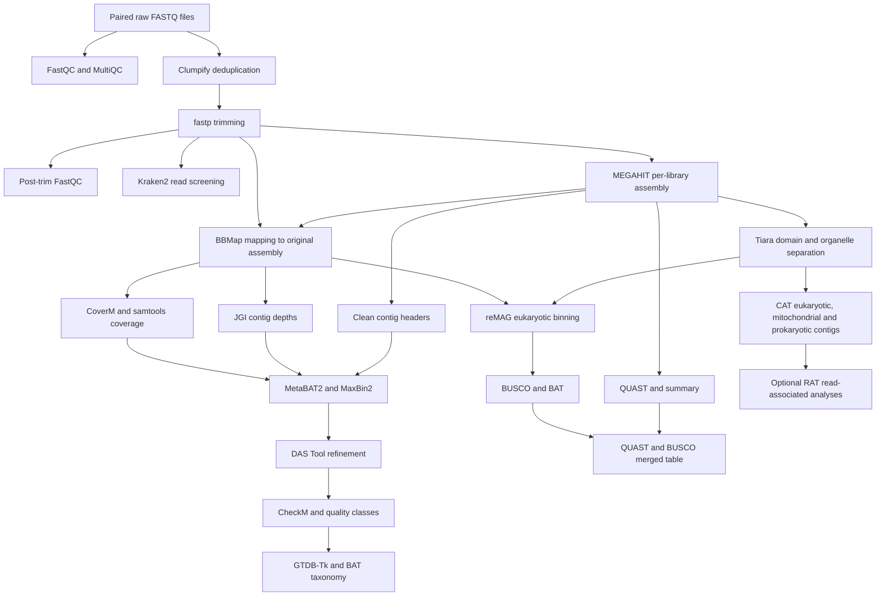

# African Freshwater eDNA Shotgun Metagenomics Pipeline

A modular Bash/SLURM workflow for paired-end Illumina environmental DNA (eDNA) shotgun metagenomes from African freshwater systems.

**Pipeline:** [`eDNA_African_freshwater_metagenomics_pipeline.sh`](eDNA_African_freshwater_metagenomics_pipeline.sh)  
**Author:** Rodgee Mae Guden  
**Research context:** KU Leuven and the Royal Museum for Central Africa (RMCA)  
**Documentation updated:** 15 October 2026

## Overview

The workflow covers read quality control, deduplication, trimming, taxonomic screening, per-library assembly, mapping, coverage estimation, prokaryotic MAG recovery, eukaryotic binning, quality assessment, and taxonomic classification. CAT/BAT/RAT provide complementary contig-, bin-, and read-associated taxonomic analyses.

It was developed for an African freshwater eDNA fragmentation experiment with 17 environmental source samples and 34 sequencing libraries representing short and long incubation conditions before extraction. The scientific objectives include testing how fragmentation affects read retention, assembly contiguity, genome recovery, taxonomic detection, and community inference. The executable currently has some project-specific assumptions, described below; the study design does not imply that every step accepts 34 samples without adjustment.

This script processes shotgun metagenomes. Metabarcoding processing, host-read removal, blank-aware contaminant filtering, functional annotation, statistical testing, and sequence-data submission are separate analyses. Paired short-versus-long statistical comparisons are not implemented in this version.

## Workflow



The prokaryotic binning steps consume the **complete cleaned assembly**, not the Tiara prokaryotic FASTA. Tiara-filtered prokaryotic contigs are used by the separate `cat_contigs_prok` and `rat_reads_prok` analyses. The eukaryotic branch uses Tiara `euk.fa`; mitochondrial CAT uses `mito.fa`.

## Inputs and configuration

Raw input must contain one gzip-compressed FASTQ pair per library. Forward reads are discovered using `*_R1*.fastq.gz`; the reverse filename is inferred by replacing `_R1` with `_R2`. The sample identifier is the basename before `_R1`.

```text
AFR001L_R1.fastq.gz
AFR001L_R2.fastq.gz
AFR001S_R1.fastq.gz
AFR001S_R2.fastq.gz
```

Keep identifiers unique and avoid whitespace or shell-special characters. Avoid underscores in sample identifiers when using the current `busco_classify` parser, which splits the sample from a BUSCO output prefix at the first underscore.

The biological metadata is tab-separated, with the first three columns in this order:

```tsv
GC_code	incubation	sample_code
AFR001L	long	AFR001-L
AFR001S	short	AFR001-S
```

`GC_code` must exactly match the sample identifier; `incubation` is the treatment; `sample_code` identifies the biological source and treatment. The retained `quast_summary` step adds metadata to assembly metrics. It reads a hard-coded `META` path inside its case block, so exporting `METADATA` alone does not redirect that step. Update that path before using another metadata location.

Export configuration before each run:

```bash
export READS_DIR=/path/to/raw_reads
export METADATA=/path/to/biological_metadata.tsv
export OUTPUT_DIR=/path/to/output
export THREADS=8
export TMPDIR=/path/to/node_local_scratch/${SLURM_JOB_ID:-local}
mkdir -p "$TMPDIR"
```

| Variable | Default or use |
| --- | --- |
| `READS_DIR` | `/staging/leuven/stg_00100/Rodgee/caves_data/concatenated_raw_reads` |
| `METADATA` | `/staging/leuven/stg_00100/Rodgee/caves_data/metadata/biological_metadata.tsv`; see the hard-coded `META` limitation above |
| `OUTPUT_DIR` | `/staging/leuven/stg_00100/Rodgee/caves_data/output` |
| `THREADS` | Top-level default `32`; export the allocated CPU count explicitly. Later step defaults do not override an already set value. |
| `SAMPLE` | Single-sample selection in supported assembly, mapping, coverage, binning, and taxonomy steps |
| `TARGET_SAMPLE` | Older selection variable accepted by selected steps; required for manual `clean_contig_headers`, `contig_lengths`, and `read_length_euk` selection |
| `DEDUP_SAMPLES`, `TRIM_SAMPLES` | Space-separated sample lists for the respective preprocessing array jobs; their order defines the array indices |
| `TRIM_DIR` | Optional assembly input override; defaults to `$OUTPUT_DIR/trimmed` in `assembly_sample` |
| `MINLEN` | MEGAHIT minimum contig length: `1000` bp |
| `MIN_LEN` | Minimum contig length for MetaBAT2, MaxBin2, and DAS Tool: `1500` bp |
| `MIN_SIZE` | CheckM minimum bin size: `50000` bp |
| `BUSCO_MIN_SIZE` | BUSCO minimum bin size: `50000` bp |
| `MAX_DEPTH` | Maximum JGI total depth retained by `filter_depth_metabat`: `10000` |
| `TMPDIR` | Writable temporary storage; mapping requires it explicitly, with at least `TMP_MIN_GB` free space |
| `TMP_MIN_GB` | Mapping free-space threshold: `20` GB |
| `FORCE` | Most computational steps rerun with `1`; three structured-summary steps require `true` instead, as described below |
| `DEBUG` | Retain selected temporary mapping files when set to `1` |
| `PPLACER_CPUS` | GTDB-Tk pplacer CPUs: `4`, capped at `THREADS` |
| `INCLUDE_LQ` | GTDB-Tk uses HQ/MQ bins by default (`0`); set `1` to include LQ bins |
| `LEVEL` | Coverage-weighted CAT abundance rank: `superkingdom` by default |
| `KRAKEN_DB`, `CAT_DB`, `CAT_TAX`, `GTDBTK_DATA_PATH` | Reference database overrides listed below |
| `CAT_CMD` | CAT/BAT/RAT executable: `CAT_pack` |
| `BIN_FILE` | Run BUSCO for a specific reMAG bin instead of a sample or array index |

## Software and databases

Use Linux, Bash with `mapfile`, GNU awk, standard GNU text/file utilities, gzip, and SLURM for array execution. Required analysis software depends on the selected steps:

| Analysis | Software |
| --- | --- |
| QC and preprocessing | FastQC, MultiQC, BBTools (`clumpify.sh`, `reformat.sh`), fastp |
| Screening, assembly, mapping | Kraken2, MEGAHIT, BBMap (`bbmap.sh`), samtools, QUAST |
| Coverage and MAG recovery | CoverM, MetaBAT2 including `jgi_summarize_bam_contig_depths`, SeqKit, MaxBin2 (`run_MaxBin.pl`), DAS Tool, DIAMOND |
| Prokaryotic quality and taxonomy | CheckM, GTDB-Tk, CAT/BAT; `bat_prok` explicitly checks Python and Pyrodigal |
| Eukaryotic and read-associated analysis | Tiara, reMAG, BUSCO, CAT/BAT/RAT (`CAT_pack`), SeqKit |

Activate an environment containing the tools required for each step. The script does not install environments or databases. `trim` and `postqc` purge and load KU Leuven modules internally; `trim` requests `fastp/1.0.1-GCC-13.3.0`. `contig_lengths` sources a hard-coded Miniforge installation and activates `seqkit_env`. Adapt these commands for another cluster before running them.

Default database locations:

```text
KRAKEN_DB=/staging/leuven/stg_00100/Rodgee/databases/kraken2_standard_20260226/db
CAT_DB=/staging/leuven/stg_00100/Rodgee/databases/CAT/20241212_CAT_nr_website/db
CAT_TAX=/staging/leuven/stg_00100/Rodgee/databases/CAT/20241212_CAT_nr_website/tax
GTDBTK_DATA_PATH=/staging/leuven/stg_00100/Rodgee/databases/gtdbtk/release232
```

`CAT_TAX` must include `names.dmp` and `nodes.dmp`. Configure the CheckM database in its environment. BUSCO uses `eukaryota_odb10`, which must be available locally or downloadable. These paths identify database snapshots; they do not establish the installed versions of every executable. Record actual tool versions, module lists or environment specifications, and database releases with each analysis.

## Running the pipeline

Always select a step explicitly:

```bash
bash eDNA_African_freshwater_metagenomics_pipeline.sh -s qc
```

Run one step per process. Although `-s step1,step2` is accepted, several successful skip or no-result paths call `exit 0`, ending the entire process before subsequent steps.

A single-sample example for supported steps:

```bash
SAMPLE=AFR001L bash eDNA_African_freshwater_metagenomics_pipeline.sh -s assembly_sample
SAMPLE=AFR001L bash eDNA_African_freshwater_metagenomics_pipeline.sh -s mapping
TARGET_SAMPLE=AFR001L bash eDNA_African_freshwater_metagenomics_pipeline.sh -s clean_contig_headers
```

Sample-level array indices are one-based. Most steps sort their own upstream file lists; some use natural/version sorting (`sort -V`). Count and inspect the exact input list for each step before submission. Array indices do not universally identify the same samples across all steps. In particular, `bat_prok` uses samples in the finished CheckM classification summary, while `gtdbtk` uses cleaned assemblies; BUSCO arrays index **bins**, not samples.

Example preprocessing submission:

```bash
mkdir -p logs
N=$(find "$READS_DIR" -maxdepth 1 -type f -name '*_R1*.fastq.gz' | wc -l)
sbatch --array=1-${N} run_pipeline_step.slurm dedup
```

Create `run_pipeline_step.slurm` with your cluster's account, partition, environment activation, and resource allocation:

```bash
#!/bin/bash -l
#SBATCH --job-name=africa_edna
#SBATCH --nodes=1
#SBATCH --ntasks=1
#SBATCH --cpus-per-task=8
#SBATCH --mem=64G
#SBATCH --time=12:00:00
#SBATCH --output=logs/%x_%A_%a.out
#SBATCH --error=logs/%x_%A_%a.err

set -euo pipefail
STEP="${1:?Provide a pipeline step}"
# Load modules or activate the environment required for STEP here.
export READS_DIR=/path/to/raw_reads
export OUTPUT_DIR=/path/to/output
export THREADS="${SLURM_CPUS_PER_TASK}"
export TMPDIR="${VSC_SCRATCH_NODE:-/tmp}/${SLURM_JOB_ID}_${SLURM_ARRAY_TASK_ID:-0}"
mkdir -p "$TMPDIR"
bash /path/to/eDNA_African_freshwater_metagenomics_pipeline.sh -s "$STEP"
```

Resource values above are examples, not validated requirements for every dataset or tool. Submit global summaries as non-array jobs after all required upstream jobs have completed successfully. Start with an individual sample to confirm environment, database, filename, and resource compatibility.

## Execution order and complete step reference

The tables below list all implemented step names. Steps are modular; optional branches need not be run for every study. All output paths are relative to `OUTPUT_DIR`.

### Reads and assembly

| Step | Purpose and main output |
| --- | --- |
| `qc` | FastQC of raw paired reads; `qc/`. Array or sequential over all libraries. |
| `multiqc` | Aggregate **raw** `qc/` reports to `multiqc/multiqc_fastqc_report.html`. Global job. |
| `dedup` | Clumpify deduplication, including optical duplicates; `dedup/<sample>_dedup_R{1,2}.fastq.gz`. Array required. |
| `trim` | fastp on deduplicated pairs; `trimmed/<sample>_trimmed_R{1,2}.fastq.gz`, HTML/JSON under `logs/fastp/`. Array required. |
| `merge_reads` | Optional paired-read interleaving using `reformat.sh`; `merged_reads/<sample>.interleaved.fastq.gz`. Array required. This does not merge overlapping read sequences. |
| `postqc` | FastQC of trimmed reads; `postqc/`. Array or sequential over all libraries. |
| `kraken_standard` | Optional Kraken2 read screening with confidence `0.1`; reports, classification output, and classified/unclassified paired reads under `kraken2_standard/`. Array required; output prefixes retain `_trimmed`. |
| `assembly_sample` | MEGAHIT per-library assembly; `assembly/<sample>/<sample>.contigs.fa`. Array or `SAMPLE`. Contig IDs are prefixed with the sample; `final.contigs.fa` links to the renamed assembly. |
| `quast` | Per-library assembly assessment; `quast/<sample>/report.txt`. Array or `SAMPLE`. |
| `quast_summary` | Assembly statistics plus biological metadata; `quast/quast_summary.tsv`. Global job; uses the hard-coded metadata path. |
| `mapping` | BBMap mapping of trimmed reads to the corresponding original assembly, with `minid=0.95`; sorted/indexed `mapping/<sample>.bam` and `.bam.bai`. Array or `SAMPLE`. |

fastp enables paired-end adapter detection, overrepresentation analysis, poly-G trimming (minimum length `30`), base correction, front/tail cutting, qualified quality Phred `20`, and minimum retained read length `50` bp. `multiqc` always reads `qc/`; it does not automatically aggregate `postqc/`. For a post-trim report, run MultiQC on `postqc/` separately or adapt that step.

### Coverage

Run coverage after mapping. `coverage_coverm` supplies both general coverage summaries and MaxBin2 input through `clean_coverm`.

| Step | Purpose and main output |
| --- | --- |
| `coverage_coverm` | Mean coverage, covered fraction, contig length, and `coverage_weighted = mean_coverage × length`; `coverage_coverm/<sample>.coverage.raw.tsv` and `<sample>.coverage.tsv`. Array or `SAMPLE`. |
| `coverage_summary_sample` | Length-weighted mean coverage across each sample's contigs; `coverage_coverm/coverage_per_sample.tsv`. Global job. |
| `coverage_samtools` | Whole-assembly mean depth and breadth using `samtools depth -aa`; `coverage_samtools/<sample>.samtools.tsv`. Array or `SAMPLE`. |
| `coverage_samtools_summary` | Combine samtools summaries; `coverage_samtools/samtools_per_sample.tsv`. Global job. |
| `coverage_metabat` | JGI contig depth table for MetaBAT2; `coverage_metabat/<sample>.depth.txt`. Array or `SAMPLE`. |
| `filter_depth_metabat` | Retain depth rows with total depth between `0` and `MAX_DEPTH`; `coverage_metabat_filtered/<sample>.depth.txt`. Array or `SAMPLE`; array mode currently insists on exactly 32 assembly directories. |

The CoverM invocation currently passes `--min-read-percent-identity 0.95` and `--min-read-aligned-percent 75`. Confirm the identity argument's interpretation in the installed CoverM version before interpreting it as a 95% threshold.

### Prokaryotic MAG branch

Recommended dependency order:

```text
clean_contig_headers
    → coverage_metabat → filter_depth_metabat → binning_metabat_prok
    → coverage_coverm → clean_coverm → binning_maxbin_prok
    → das_tool_prok → checkm_prok → checkm_classify_prok
    → checkm_summary_sample_prok
    → gtdbtk → gtdbtk_summary → gtdbtk_merge_checkm
    → bat_prok → bat_prok_summary_structured
```

The MetaBAT2 and MaxBin2 branches can run independently once their own inputs exist. MetaBAT2 prefers filtered depths, with a logged fallback to raw depths.

| Step | Purpose and main output |
| --- | --- |
| `clean_contig_headers` | Strip descriptions/whitespace from assembly headers; `assembly_clean/<sample>/<sample>.contigs.clean.fa`. Array, `TARGET_SAMPLE`, or sequential over all assemblies. |
| `binning_metabat_prok` | Filter by minimum length and match contig IDs to depth rows before MetaBAT2; `binning_metabat_prok/<sample>/bin*.fa`. Array or `SAMPLE`. |
| `clean_coverm` | Match cleaned assembly IDs to positive CoverM mean coverage and write MaxBin2's two-column abundance input; `coverage_coverm_clean/<sample>.coverm.clean.tsv`. Array, `SAMPLE`, or sequential over coverage files. |
| `binning_maxbin_prok` | MaxBin2 with matched cleaned contigs/abundance; `binning_maxbin_prok/<sample>/`. Array or `SAMPLE`. |
| `das_tool_prok` | Refine available MetaBAT2/MaxBin2 bin sets using DIAMOND and score threshold `0.5`; `das_tool_prok/<sample>/<sample>_DASTool_bins/`. A single available bin set is allowed. Array or `SAMPLE`. |
| `checkm_prok` | Filter refined bins by size, run `lineage_wf`, and generate the tabular QA report within this step; `checkm_prok/<sample>/`. Array or `SAMPLE`. |
| `checkm_classify_prok` | Global HQ/MQ/LQ classification and bin copying; `checkm_classified_prok/{HQ,MQ,LQ}/` and `checkm_summary.tsv`. Validates new output before replacing prior classification. |
| `checkm_summary_sample_prok` | Global summary representing all cleaned assemblies, with `classified`, `NO_BINS`, or `NO_CHECKM_RESULT` status; `checkm_classified_prok/checkm_summary_per_sample.tsv`. |
| `gtdbtk` | GTDB-Tk classification of HQ/MQ MAGs by default; `gtdbtk/<sample>/`. Array or `SAMPLE`; `INCLUDE_LQ=1` adds LQ bins. |
| `gtdbtk_summary` | Global combination of bacterial/archaeal classification summaries with rank columns; `gtdbtk/gtdbtk_summary.tsv`. |
| `gtdbtk_merge_checkm` | Join taxonomy to CheckM metrics; `gtdbtk/gtdbtk_checkm_merged.tsv`. Global job. |
| `bat_prok` | Complementary BAT classification of classified HQ/MQ/LQ MAGs; `bat_prok/<sample>/<sample>.bin2classification.txt`. Requires `CLASSIFICATION_COMPLETE`; array or `SAMPLE`. |
| `bat_prok_summary_structured` | Per-sample taxonomic ranks and combined `bat_prok_summary/all_samples.taxonomy_structured.tsv`. Global job. |

CheckM workflow categories are HQ at completeness ≥90% and contamination ≤5%, MQ at completeness ≥50% and contamination ≤10% after excluding HQ, and LQ otherwise. These are operational completeness/contamination categories; additional criteria required for formal genome-quality standards are not assessed by these thresholds alone.

### Eukaryotic, mitochondrial, and optional RAT analyses

Run `tiara_split` after assembly; run reMAG after mapping. CAT contig classification and reMAG binning can proceed independently. RAT requires the corresponding CAT contig results and trimmed paired reads.

| Step | Purpose and main output |
| --- | --- |
| `tiara_split` | Tiara with minimum length `3000` bp, followed by FASTA splitting; `tiara/<sample>/tiara.txt`, `euk.fa`, `prok.fa`, `organelle.fa`, `mito.fa`, and `plastid.fa` when the corresponding group is present. Array or `SAMPLE`. |
| `cat_contigs` | CAT on Tiara eukaryotic contigs; `cat_contigs/<sample>/`. Array or `SAMPLE`. |
| `cat_contigs_summary_structured` | Structured eukaryotic contig ranks; `cat_contigs_summary/<sample>.taxonomy_structured.tsv`. Global job. |
| `cat_contigs_taxon_abundance` | Sum length-weighted coverage for classified taxa at `LEVEL`; `cat_contigs_summary/taxon_abundance_<LEVEL>.tsv`. Requires structured CAT output and `coverage_coverm`. Global job. |
| `contig_lengths` | SeqKit lengths of eukaryotic contigs; `contig_lengths/<sample>_lengths.tsv`. Array, `TARGET_SAMPLE`, or all samples sequentially. |
| `cat_mito_contigs` | CAT on Tiara mitochondrial contigs; `cat_mito/<sample>/`. Array or `SAMPLE`. |
| `cat_mito_summary_structured` | Structured mitochondrial ranks; `cat_mito_summary/<sample>.mito.taxonomy_structured.tsv`. Global job. |
| `remag` | Bin Tiara eukaryotic contigs using the whole-assembly BAM and `--skip-bacterial-filter`; `remag/<sample>/bins/` and `bins.csv` when produced. Array or `SAMPLE`. |
| `busco` | Assess reMAG bins of at least `BUSCO_MIN_SIZE` using `eukaryota_odb10` in genome mode; `busco/<sample>_<bin>/`. Bin array, `SAMPLE`, or `BIN_FILE`. |
| `busco_classify` | Workflow HQ/MQ/LQ bin classes and copies; `busco_classified/busco_summary.tsv` and `{HQ,MQ,LQ}/`. Global job. |
| `busco_summary_sample` | Mean completeness, fragmentation, missing BUSCOs, and bin counts; `busco_classified/busco_summary_per_sample.tsv`. Global job. |
| `bat_bins` | BAT taxonomy of reMAG bins; `bat_bins/<sample>/`. Array or `SAMPLE`. |
| `bat_bins_summary_structured` | Structured eukaryotic bin ranks; `bat_bins_summary/<sample>.taxonomy_structured.tsv`. Global job. |
| `cat_contigs_prok` | CAT on Tiara prokaryotic contigs; `cat_contigs_prok/<sample>/`. Array or `SAMPLE`. |
| `rat_reads` | Optional RAT analysis using eukaryotic CAT contigs and trimmed reads; `rat_reads/<sample>/`, with temporary cleaned contigs under `tiara_clean/`. Array or `SAMPLE`. |
| `rat_reads_prok` | Corresponding prokaryotic RAT analysis; `rat_reads_prok/<sample>/`, with temporary cleaned contigs under `tiara_clean_prok/`. Array or `SAMPLE`. |
| `rat_reads_summary_structured` | Structured RAT taxonomy and associated read/coverage fields; `rat_reads_summary/<sample>.taxonomy_structured.tsv`. Global job. |
| `rat_reads_summary_structured_prok` | Corresponding prokaryotic RAT summary; `rat_reads_summary_prok/<sample>.taxonomy_structured.tsv`. Global job. |
| `read_length_euk` | Extract BAM reads mapping to references assigned Eukaryota in the structured RAT table; `read_length_euk/<sample>.read_length.tsv` contains sample, count, mean, and median without a header. Array or `TARGET_SAMPLE`. |
| `quast_busco_merged` | Join assembly metrics to aggregated BUSCO metrics; `quast/quast_busco_merged.tsv`. Global job. Missing BUSCO values are converted to numeric zero, so inspect underlying summaries when distinguishing missing data from biological absence. |

BUSCO-based HQ uses complete BUSCOs ≥90% and duplicated BUSCOs ≤5%; MQ uses complete BUSCOs ≥50% and duplicated BUSCOs ≤10% after excluding HQ; LQ contains the remainder. Duplicated BUSCO percentage is not a CheckM contamination estimate. Report these as workflow-specific eukaryotic-bin classes.

CAT coverage-weighted abundance is a sum of mean depth × contig length for classified contigs, not a normalized relative-read abundance. RAT summaries retain their own read-count, fraction, and coverage fields. Specify the measure used in downstream comparisons.

## Restart behavior and current limitations

The script uses `set -euo pipefail` and an error trap. The general log is `logs/edna_pipeline.log`; many computational steps also write per-sample logs under `logs/<step>/`. Some summary blocks redefine the logging function to stdout only, so preserve scheduler logs as well.

Most computational steps skip existing outputs unless `FORCE=1`. Prokaryotic steps also use completion or no-bin markers, including `METABAT_COMPLETE`, `MAXBIN_COMPLETE`, `DASTOOL_COMPLETE`, `CHECKM_COMPLETE`, `BAT_COMPLETE`, `GTDBTK_COMPLETE`, `NO_BINS`, and `NO_ELIGIBLE_MAGS`. A successful no-bin result differs from a missing or failed analysis. If inputs, thresholds, or database versions change, rerun affected downstream steps explicitly; cached outputs and markers are not automatically invalidated.

Use `FORCE=true` for `cat_contigs_summary_structured`, `rat_reads_summary_structured`, and `rat_reads_summary_structured_prok`. Their string comparisons do not treat `FORCE=1` as a rerun request. Other summaries may overwrite outputs unconditionally. Forced computational reruns can remove the existing sample output directory.

Known portability and interpretation limits in the current script:

- KU Leuven paths, module commands, and the `seqkit_env` activation need adaptation on other systems. `quast_summary` uses its own hard-coded metadata path.
- `filter_depth_metabat` array mode requires exactly 32 assembly directories. Use explicit `SAMPLE` runs or revise that project-specific check for another dataset.
- `busco_classify` splits the sample identifier at the first underscore. Check sample/bin attribution if input sample names contain underscores.
- `quast_busco_merged` uses fixed temporary filenames (`tmp.quast`, `tmp.busco`) in the working directory. Run it once in an isolated working directory.
- Taxonomy parsers expect the CAT/BAT/RAT column layout and taxonomy ranks encoded in the script. Confirm compatibility with the installed tool/database release before drawing biological conclusions.

This update documents the supplied workflow; it does not establish a completed end-to-end HPC run, validated biological results, or universal compatibility with every tool release. Preserve tool versions, run logs, metadata, and database snapshots for reproducibility.

## Validation

Run the lightweight checks from the repository root:

```bash
bash -n eDNA_African_freshwater_metagenomics_pipeline.sh
python3 -m unittest discover -s tests -v
```

The nine synthetic tests cover explicit step selection, preservation of GTDB species names containing spaces, current and legacy MAG identifier joins, repeatable BAT summary generation, and reMAG success, no-bin, cached-output, and failure handling. They use small fixtures and a stand-in reMAG executable, so they do not require sequencing data, reference databases, or installed bioinformatics tools.

The GitHub Actions workflow in `.github/workflows/validate-pipeline.yml` runs the same syntax and synthetic checks on Ubuntu for pushes and pull requests. These checks do not constitute an end-to-end HPC run or validation of biological results. Confirm tool/database compatibility and resources with representative samples before a full analysis.

## Interpretation, citation, and licence

Interpret fragmentation effects separately at the read, assembly, genome-recovery, taxonomic, and community levels. A difference in assembly contiguity or bin recovery need not indicate an equivalent difference in the source biological community. Paired treatment statistics and their sign conventions should be defined in the downstream analysis.

This workflow was developed by Rodgee Mae Guden for shotgun metagenomic eDNA analyses of African freshwater systems in collaboration with KU Leuven and the Royal Museum for Central Africa.

The workflow and documentation are licensed under the **Creative Commons Attribution 4.0 International Licence (CC BY 4.0)**; see [`LICENSE`](LICENSE). Users may share and adapt the material with appropriate credit, a licence link, and an indication of modifications. External tools and databases retain their respective licences and terms.

When using or adapting this workflow, cite the associated Figshare repository, archived pipeline version, or related publication.

## Contact

**Rodgee Mae Guden**  
Postdoctoral researcher  
Laboratory of Ecology, Evolution and Biodiversity Conservation  
Department of Biology, KU Leuven  
Leuven, Belgium  
Email: `rodgee.guden@kuleuven.be`
