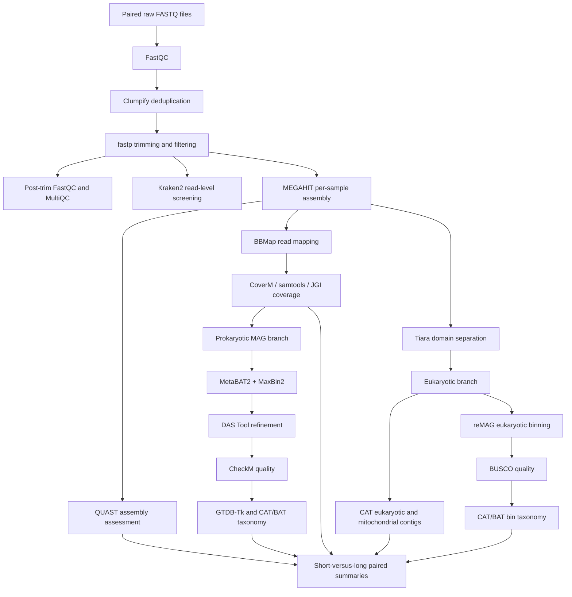

# African Freshwater eDNA Shotgun Metagenomics Pipeline
A modular Bash/SLURM workflow for processing Illumina paired-end environmental DNA (eDNA) shotgun metagenomes from African freshwater systems.
---
Pipeline script: `eDNA_Africa_freshwater.sh`  
Author: Rodgee Mae Guden
---
Project context: African freshwater eDNA research conducted in collaboration between KU Leuven and the Royal Museum for Central Africa (RMCA)  
README version: 0.1 — 28 July 2026
---
## 1. Overview

This pipeline processes paired-end Illumina shotgun metagenomic data from raw FASTQ files through quality control, read preprocessing, taxonomic classification, assembly, coverage estimation, prokaryotic and eukaryotic genome binning, bin-quality assessment, taxonomic assignment, and cross-treatment summaries.
The workflow was initially developed for an African freshwater eDNA fragmentation experiment in which environmental source samples were represented by paired sequencing libraries exposed to short and long incubation conditions before DNA extraction. The current study design contains 17 environmental source samples and 34 shotgun-metagenomic libraries. The pipeline can also be adapted to other African freshwater systems, including caves, rivers, lakes, and future sampling campaigns Africa.
The main scientific objectives are to evaluate how pre-analytical DNA fragmentation influences:
sequence quality and read retention;
assembly contiguity and total assembly size;
recovery of eukaryotic, mitochondrial, and prokaryotic contigs;
read-, contig-, and bin-level taxonomic detection;
recovery and quality of prokaryotic MAGs and eukaryotic bins;
coverage-weighted taxonomic abundance; and
the robustness of community-level biodiversity inference.
The script does not process the complementary metabarcoding dataset. It is specifically designed for shotgun metagenomic libraries.

---
## 2. Recommended workflow

Current recommended taxonomic strategy
For the current project, the preferred eukaryotic workflow is:
```text
MEGAHIT assembly
    → Tiara domain separation
    → CAT on Tiara-filtered eukaryotic contigs
    → CAT on mitochondrial contigs
    → reMAG binning
    → BUSCO quality assessment
    → BAT classification of eukaryotic bins
```
---
## 3. Input data
### 3.1 Raw-read naming convention
Raw reads must be gzip-compressed paired-end FASTQ files. The pipeline identifies forward reads using:
```text
*_R1*.fastq.gz
```
The matching reverse read is inferred by replacing `_R1` with `_R2`.
Recommended naming:
```text
AFR001_L_R1.fastq.gz
AFR001_L_R2.fastq.gz
AFR001_S_R1.fastq.gz
AFR001_S_R2.fastq.gz
```
Here, `_L` and `_S` may represent long- and short-incubation libraries, respectively. The sample basename extracted from the R1 filename is used throughout the output structure, so filenames must be unique and consistent.
Avoid spaces, tabs, and shell-special characters in sample names.

### 3.2 Biological metadata
The pipeline expects a tab-separated metadata file. Several comparison steps assume the following first three columns:
```text
GC_code    incubation    sample_code
AFR001_L   long          AFR001-L
AFR001_S   short         AFR001-S
AFR002_L   long          AFR002-L
AFR002_S   short         AFR002-S
```
Column definitions:
| Column | Description |
|---|---|
| `GC_code` | Exact sample basename used in FASTQ files and output directories |
| `incubation` | Treatment label; currently expected to be `short` or `long` |
| `sample_code` | Paired biological-source identifier with a terminal `-S` or `-L` |

The paired-comparison code removes the terminal `-S` or `-L` from `sample_code` to match short and long libraries from the same environmental source.
For example:
```text
AFR001-L → AFR001
AFR001-S → AFR001
```
Additional metadata columns may be included after these required columns.

### 3.3 Important metadata limitation

Although the script defines a top-level `METADATA` environment variable, some summary steps currently use a hard-coded metadata path. Before running on a different system or project, replace those hard-coded paths or revise the script so every step consistently uses `$METADATA`.

---
## 4. Main configuration

The following variables can be exported before running the pipeline:

| Variable           | Default or purpose                                                                                                                 |
| ------------------ | ---------------------------------------------------------------------------------------------------------------------------------- |
| `READS_DIR`        | Directory containing the raw paired-end FASTQ files                                                                                |
| `METADATA`         | Path to the biological metadata TSV file                                                                                           |
| `OUTPUT_DIR`       | Root directory for all pipeline outputs                                                                                            |
| `THREADS`          | Number of processing threads. The top-level default is 32, although several steps define their own default                         |
| `FORCE`            | Set to `1` to overwrite or regenerate existing outputs in most steps                                                               |
| `TARGET_SAMPLE`    | Run supported steps for one specified sample                                                                                       |
| `SAMPLE`           | Alternative single-sample override used by selected steps                                                                          |
| `TMPDIR`           | Node-local temporary directory. Required or strongly recommended for mapping, CAT/BAT, GTDB-Tk, and other resource-intensive steps |
| `TMP_MIN_GB`       | Minimum free space required in `TMPDIR` by the mapping step. The default is 20 GB                                                  |
| `DEBUG`            | Set to `1` to retain selected temporary files                                                                                      |
| `MINLEN`           | Minimum contig length produced by MEGAHIT. The default is 1,000 bp                                                                 |
| `MIN_LEN`          | Minimum contig length used during binning. This is usually 1,500 bp                                                                |
| `MAX_DEPTH`        | Maximum accepted MetaBAT depth value. The default is 10,000                                                                        |
| `LEVEL`            | Taxonomic rank used for coverage-weighted abundance summaries. The default is `superkingdom`                                       |
| `KRAKEN_DB`        | Path to the Kraken2 reference database                                                                                             |
| `CAT_DB`           | Path to the CAT/BAT sequence database                                                                                              |
| `CAT_TAX`          | Path to the CAT/BAT taxonomy database                                                                                              |
| `CAT_CMD`          | CAT executable name or path. The default is `CAT_pack`                                                                             |
| `GTDBTK_DATA_PATH` | Path to the GTDB-Tk reference database                                                                                             |

### Example configuration

```bash
export READS_DIR=/path/to/raw_reads
export METADATA=/path/to/biological_metadata.tsv
export OUTPUT_DIR=/path/to/output
export THREADS=8
export TMPDIR=/path/to/node_local_scratch/${SLURM_JOB_ID}

mkdir -p "$TMPDIR"
```
---
## 5. Software requirements

The pipeline is designed for a Linux high-performance computing environment using Bash and SLURM. Most sample-level steps are intended to run as SLURM array jobs.

### 5.1 Core utilities

* Bash
* GNU `awk`
* GNU `grep`
* `sed`
* `sort`
* `find`
* `gzip`
* `zcat`
* GNU Coreutils

### 5.2 Read quality control and preprocessing

* FastQC
* MultiQC
* BBTools, including:

  * `clumpify.sh`
  * `reformat.sh`
* fastp

### 5.3 Read classification, assembly, and mapping

* Kraken2
* MEGAHIT
* BBMap
* samtools
* QUAST
* CoverM
* MetaBAT2 utilities, including:

  * `jgi_summarize_bam_contig_depths`
* SeqKit

### 5.4 Prokaryotic MAG recovery and classification

* MetaBAT2
* MaxBin2
* DAS Tool
* DIAMOND
* CheckM
* GTDB-Tk
* CAT/BAT/RAT through `CAT_pack`

### 5.5 Eukaryotic analysis

* Tiara
* reMAG
* BUSCO
* CAT/BAT/RAT through `CAT_pack`

### 5.6 Software and database versions

The following software versions and database snapshots are associated with the current pipeline implementation:

| Software or database       | Version or release                                      |
| -------------------------- | ------------------------------------------------------- |
| MEGAHIT                    | 1.2.9                                                   |
| BBMap                      | 39.19                                                   |
| fastp                      | `1.0.1-GCC-13.3.0` in the current KU Leuven environment |
| Kraken2 standard database  | Database snapshot dated 26 February 2026                |
| CAT database               | Database snapshot dated 12 December 2024                |
| GTDB-Tk reference database | Release 232                                             |
| BUSCO lineage              | `eukaryota_odb10`                                       |

For reproducibility, record the exact version reported by each executable and archive the corresponding Conda environment, module list, or environment specification together with the pipeline.

---
## 6. Reference databases
Kraken2
Current default:
```text
/staging/leuven/stg_00100/Rodgee/databases/kraken2_standard_20260226/db
```
Override with:
```bash
export KRAKEN_DB=/path/to/kraken2/database
```
CAT/BAT
Current defaults:
```text
CAT database: /staging/leuven/stg_00100/Rodgee/databases/CAT/20241212_CAT_nr_website/db
CAT taxonomy: /staging/leuven/stg_00100/Rodgee/databases/CAT/20241212_CAT_nr_website/tax
```
Override with:
```bash
export CAT_DB=/path/to/CAT/database
export CAT_TAX=/path/to/CAT/taxonomy
```
The taxonomy directory must contain at least:
```text
names.dmp
nodes.dmp
```
GTDB-Tk
Current default:
```text
/staging/leuven/stg_00100/Rodgee/databases/gtdbtk/release232
```
Override with:
```bash
export GTDBTK_DATA_PATH=/path/to/gtdbtk/release
```
BUSCO
The eukaryotic bins are assessed against:
```text
eukaryota_odb10
```
The lineage must be installed or downloadable in the BUSCO environment.

The CheckM database location is expected to be configured in the activated CheckM environment.

---
## 7. Running the pipeline

Make the pipeline executable:
```bash
chmod +x eDNA_Africa_freshwater.sh
```
Always provide a step name explicitly:
```bash
bash eDNA_Africa_freshwater.sh -s qc
```
The script accepts comma-separated step names:
```bash
bash eDNA_Africa_freshwater.sh -s qc,multiqc
```

### 7.1 Sequential step
Steps such as `multiqc`, `quast_summary`, and final table-merging steps should normally be run as a single non-array job:
```bash
bash eDNA_Africa_freshwater.sh -s multiqc
```
### 7.2 SLURM-array step
Determine the number of libraries:
```bash
N=$(find "$READS_DIR" -maxdepth 1 -type f -name '*_R1*.fastq.gz' | wc -l)
echo "$N"
```
Submit an array job using the same sorted sample order used by the pipeline:
```bash
sbatch --array=1-${N} run_pipeline_step.slurm dedup
```
Example wrapper:
```bash
#!/bin/bash -l
#SBATCH --job-name=africa_edna
#SBATCH --account=l_fishgenomics_at_kul
#SBATCH --clusters=wice
#SBATCH --partition=batch
#SBATCH --nodes=1
#SBATCH --ntasks=1
#SBATCH --cpus-per-task=8
#SBATCH --mem=64G
#SBATCH --time=12:00:00
#SBATCH --output=logs/%x_%A_%a.out
#SBATCH --error=logs/%x_%A_%a.err

set -euo pipefail

STEP="${1:?Provide a pipeline step}"

module --force purge
module load cluster/genius/batch

# Activate the environment appropriate for STEP.
# source activate africa_edna

export READS_DIR=/staging/leuven/stg_00100/Rodgee/caves_data/concatenated_raw_reads
export METADATA=/staging/leuven/stg_00100/Rodgee/caves_data/metadata/biological_metadata.tsv
export OUTPUT_DIR=/staging/leuven/stg_00100/Rodgee/caves_data/output
export THREADS="${SLURM_CPUS_PER_TASK}"

export TMPDIR="${VSC_SCRATCH_NODE:-/tmp}/${SLURM_JOB_ID}_${SLURM_ARRAY_TASK_ID:-0}"
mkdir -p "$TMPDIR"

bash eDNA_Africa_freshwater.sh -s "$STEP"
```
Different steps require different environments and resources. In practice, separate SLURM wrappers or conditional module/Conda activation may be easier to maintain than one universal wrapper.
### 7.3 Run one supported sample
Selected steps accept `TARGET_SAMPLE`:
```bash
export TARGET_SAMPLE=AFR001_L
bash eDNA_Africa_freshwater.sh -s cat_contigs
```
Selected steps instead use `SAMPLE`:
```bash
export SAMPLE=AFR001_L
bash eDNA_Africa_freshwater.sh -s filter_depth_metabat
```
Check the relevant step before assuming that both overrides are supported.
### 7.4 Force a rerun
Most steps skip valid existing output files. To rerun:
```bash
export FORCE=1
bash eDNA_Africa_freshwater.sh -s assembly_sample
```
Use this carefully because some steps delete existing output directories before rerunning.

---
## 8. Suggested execution order
The workflow is modular. Not every step is required for every analysis.

## 8.1 Read preprocessing and initial screening

|    Order | Step              | Mode                | Main purpose                                                                                                            |
| -------: | ----------------- | ------------------- | ----------------------------------------------------------------------------------------------------------------------- |
|        1 | `qc`              | Array or sequential | Run FastQC on the raw paired-end reads                                                                                  |
|        2 | `multiqc`         | Single job          | Aggregate the raw-read FastQC reports                                                                                   |
|        3 | `dedup`           | Array               | Remove duplicate and optical-duplicate read pairs using Clumpify                                                        |
|        4 | `trim`            | Array               | Perform adapter detection, quality trimming, poly-G trimming, base correction, and minimum-length filtering using fastp |
|        5 | `postqc`          | Array or sequential | Run FastQC on the trimmed reads                                                                                         |
|        6 | `multiqc`         | Single job          | Aggregate the post-trimming QC reports after configuring the appropriate input directory                                |
| Optional | `merge_reads`     | Array               | Interleave paired reads using `reformat.sh`. This step does not merge overlapping read sequences                        |
| Optional | `kraken_standard` | Array               | Perform read-level taxonomic screening using Kraken2                                                                    |

The trimming step currently uses the following settings:

```text
Qualified base quality: Phred 20
Minimum retained read length: 50 bp
Minimum poly-G length: 30 bp
Paired-end adapter detection: enabled
Base correction: enabled
Front trimming: enabled
Tail trimming: enabled
```

## 8.2 Assembly, mapping, and assembly quality

| Order | Step                       | Mode       | Main purpose                                                                                              |
| ----: | -------------------------- | ---------- | --------------------------------------------------------------------------------------------------------- |
|     7 | `assembly_sample`          | Array      | Perform a separate MEGAHIT assembly for each library, using a default minimum contig length of 1,000 bp   |
|     8 | `quast`                    | Array      | Assess the quality of each individual assembly                                                            |
|     9 | `quast_summary`            | Single job | Combine contig count, total assembly length, N50, and GC content into one TSV file                        |
|    10 | `quast_compare_incubation` | Single job | Pair the long- and short-incubation libraries and calculate differences in assembly metrics               |
|    11 | `mapping`                  | Array      | Map the trimmed reads to the corresponding assembly using BBMap and generate sorted and indexed BAM files |

The mapping step currently applies:

```text
Minimum sequence identity: 0.95
```

The mapping step also requires a writable `TMPDIR` containing at least 20 GB of free space by default.

## 8.3 Coverage estimation

Several coverage implementations are included because different downstream tools require different coverage formats.

| Step                        | Purpose                                                                                           | Main output                                       |
| --------------------------- | ------------------------------------------------------------------------------------------------- | ------------------------------------------------- |
| `coverage_coverm`           | Calculate per-contig mean coverage, covered fraction, contig length, and length-weighted coverage | `coverage/<sample>.coverage.tsv`                  |
| `coverage_summary_sample`   | Calculate length-weighted mean coverage for each sample                                           | `coverage/coverage_per_sample.tsv`                |
| `coverage_samtools`         | Calculate whole-assembly mean depth and breadth using `samtools depth -aa`                        | `coverage_samtools/<sample>.samtools.tsv`         |
| `coverage_samtools_summary` | Combine the per-sample samtools coverage summaries                                                | `coverage_samtools/samtools_per_sample.tsv`       |
| `coverage_metabat`          | Generate the JGI contig-depth table required by MetaBAT2                                          | `coverage_metabat/<sample>.depth.txt`             |
| `filter_depth_metabat`      | Remove implausibly high depth values before binning                                               | `coverage_metabat_filtered/<sample>.depth.txt`    |
| `coverm_prok`               | Generate full-assembly contig coverage for MaxBin2                                                | `coverage_coverm/<sample>.coverm.tsv`             |
| `clean_coverm`              | Convert CoverM output into a MaxBin2-compatible abundance table                                   | `coverage_coverm_clean/<sample>.coverm.clean.tsv` |

The CoverM contig-coverage calculation currently uses:

```text
Minimum read identity: 95%
Minimum aligned read fraction: 75%
```

## 8.4 Prokaryotic MAG branch

### Recommended order

```text
clean_contig_headers
    → coverage_metabat
    → filter_depth_metabat
    → binning_metabat_prok
    → coverm_prok
    → clean_coverm
    → binning_maxbin_prok
    → das_tool_prok
    → checkm_prok
    → checkm_qa_prok, when QA regeneration is required
    → checkm_classify_prok
    → checkm_summary_sample_prok
    → gtdbtk
    → gtdbtk_summary
    → gtdbtk_merge_checkm
    → bat_prok, optional complementary taxonomy
    → bat_prok_summary_structured
```

| Step                          | Purpose                                                                                      |
| ----------------------------- | -------------------------------------------------------------------------------------------- |
| `clean_contig_headers`        | Remove whitespace and additional descriptions from MEGAHIT FASTA headers                     |
| `binning_metabat_prok`        | Perform MetaBAT2 binning using contigs of at least 1,500 bp by default                       |
| `binning_maxbin_prok`         | Perform MaxBin2 binning using cleaned CoverM abundance estimates                             |
| `das_tool_prok`               | Integrate the MetaBAT2 and MaxBin2 results and generate a refined, non-redundant set of bins |
| `checkm_prok`                 | Run the CheckM lineage workflow on the DAS Tool bins                                         |
| `checkm_qa_prok`              | Regenerate the CheckM QA tables without repeating the full lineage workflow                  |
| `checkm_classify_prok`        | Classify and copy bins into high-quality, medium-quality, and low-quality directories        |
| `checkm_summary_sample_prok`  | Aggregate CheckM quality metrics by sample                                                   |
| `gtdbtk`                      | Classify the prokaryotic MAGs using GTDB-Tk                                                  |
| `gtdbtk_summary`              | Combine bacterial and archaeal GTDB-Tk classification results                                |
| `gtdbtk_merge_checkm`         | Merge GTDB-Tk taxonomy with CheckM quality metrics                                           |
| `bat_prok`                    | Perform complementary taxonomic classification of prokaryotic MAGs using CAT/BAT             |
| `bat_prok_summary_structured` | Convert BAT classifications into explicit taxonomic ranks                                    |
| `cat_contigs_prok`            | Perform CAT classification of Tiara-filtered prokaryotic contigs                             |

### CheckM quality categories

The current script applies the following operational quality categories:

| Category |       Completeness |      Contamination |
| -------- | -----------------: | -----------------: |
| HQ       |               ≥90% |                ≤5% |
| MQ       |               ≥50% |               ≤10% |
| LQ       | All remaining bins | All remaining bins |

These are operational categories used by the workflow. The exact thresholds should be reported in downstream analyses, data releases, and publications.

## 8.5 Eukaryotic and mitochondrial branch

### Recommended order

```text
tiara_split
    → cat_contigs
    → cat_contigs_summary_structured
    → cat_contigs_taxon_abundance
    → contig_lengths
    → cat_mito_contigs
    → cat_mito_summary_structured
    → remag
    → busco
    → busco_classify
    → busco_summary_sample
    → bat_bins
    → bat_bins_summary_structured
```

| Step                             | Purpose                                                                                                     |
| -------------------------------- | ----------------------------------------------------------------------------------------------------------- |
| `tiara_split`                    | Separate assembled contigs into eukaryotic, prokaryotic, organellar, mitochondrial, and plastid FASTA files |
| `cat_contigs`                    | Perform CAT classification of the Tiara-classified eukaryotic contigs                                       |
| `cat_contigs_summary_structured` | Convert CAT output into explicit taxonomic ranks                                                            |
| `cat_contigs_taxon_abundance`    | Sum length-weighted contig coverage at a selected taxonomic rank                                            |
| `contig_lengths`                 | Extract the lengths of eukaryotic contigs                                                                   |
| `cat_mito_contigs`               | Perform CAT classification of mitochondrial contigs                                                         |
| `cat_mito_summary_structured`    | Convert mitochondrial CAT classifications into explicit taxonomic ranks                                     |
| `remag`                          | Bin Tiara-classified eukaryotic contigs using the corresponding whole-assembly BAM file                     |
| `busco`                          | Assess eukaryotic bins using the `eukaryota_odb10` lineage dataset                                          |
| `busco_classify`                 | Assign bins to workflow-specific HQ, MQ, or LQ categories                                                   |
| `busco_summary_sample`           | Aggregate eukaryotic-bin quality metrics by sample                                                          |
| `bat_bins`                       | Perform BAT taxonomic classification of the reMAG bins                                                      |
| `bat_bins_summary_structured`    | Convert BAT bin classifications into explicit taxonomic ranks                                               |

The BUSCO step skips bins smaller than 50 kb.

### BUSCO-based operational categories

The script currently uses complete and duplicated BUSCO percentages as follows:

| Category |    Complete BUSCOs |  Duplicated BUSCOs |
| -------- | -----------------: | -----------------: |
| HQ       |               ≥90% |                ≤5% |
| MQ       |               ≥50% |               ≤10% |
| LQ       | All remaining bins | All remaining bins |

Duplicated BUSCO percentage is not equivalent to the contamination estimate produced by CheckM. These categories should therefore be described as workflow-specific eukaryotic-bin quality classes rather than direct equivalents of the prokaryotic MIMAG categories.

## 8.6 Optional RAT branch for read-level abundance analysis

RAT provides read-level taxonomic classification and can be used when taxonomic abundance estimates are required. In contrast, CAT primarily assigns taxonomy to assembled contigs and is therefore more suitable for identifying the taxonomic origin of contigs than for directly quantifying read abundance.

The RAT branch is optional for workflows focused only on contig classification. However, it should be run when read-level abundance estimates or comparisons among samples and treatments are needed.

| Step                                | Purpose                                                                       |
| ----------------------------------- | ----------------------------------------------------------------------------- |
| `rat_reads`                         | Classify reads associated with Tiara-classified eukaryotic contigs using RAT  |
| `rat_reads_prok`                    | Classify reads associated with Tiara-classified prokaryotic contigs using RAT |
| `rat_reads_summary_structured`      | Convert eukaryotic RAT classifications into structured taxonomic ranks        |
| `rat_reads_summary_structured_prok` | Convert prokaryotic RAT classifications into structured taxonomic ranks       |
| `read_length_euk`                   | Extract the lengths of reads mapping to contigs classified as Eukaryota       |

Use the eukaryotic RAT steps when abundance estimates are required for eukaryotic taxa.

Use the prokaryotic RAT steps when abundance estimates are required for bacterial or archaeal taxa.

These steps may be skipped when the analysis is limited to contig-level taxonomic identification using CAT. When reporting RAT-derived abundance, clearly specify whether values represent classified read counts, relative read abundance, or another normalised abundance measure.

## 8.7 Combined and paired comparisons

| Step                               | Main output or comparison                                                            |
| ---------------------------------- | ------------------------------------------------------------------------------------ |
| `quast_busco_merged`               | Merge assembly metrics with aggregated BUSCO metrics                                 |
| `compare_incubation_full_taxonomy` | Compare bin taxonomy and BUSCO quality between short- and long-incubation libraries  |
| `compare_incubation_quast_busco`   | Perform paired comparisons of assembly and BUSCO metrics                             |
| `compare_incubation_full`          | Perform paired comparisons of QUAST metrics, BUSCO metrics, coverage, and bin counts |

For the paired comparisons, delta values are calculated as:

```text
Long incubation − short incubation
```

For example, a positive `delta_N50` means that the N50 was higher in the long-incubation library than in the corresponding short-incubation library.

Confirm the sign convention before interpreting or reporting the statistical results.

## 9. Complete step reference
Read preprocessing
```text
qc
multiqc
dedup
trim
merge_reads
postqc
kraken_standard
```
Assembly and coverage
```text
assembly_sample
mapping
quast
quast_summary
quast_compare_incubation
coverage_coverm
coverage_summary_sample
coverage_samtools
coverage_samtools_summary
coverage_metabat
filter_depth_metabat
clean_contig_headers
```
Prokaryotic MAGs
```text
binning_metabat_prok
coverm_prok
clean_coverm
binning_maxbin_prok
das_tool_prok
checkm_prok
checkm_qa_prok
checkm_classify_prok
checkm_summary_sample_prok
bat_prok
gtdbtk
gtdbtk_summary
gtdbtk_merge_checkm
cat_contigs_prok
bat_prok_summary_structured
```
Eukaryotic and organellar analyses
```text
tiara_split
cat_contigs
contig_lengths
cat_mito_contigs
remag
busco
busco_classify
busco_summary_sample
bat_bins
cat_contigs_summary_structured
cat_mito_summary_structured
bat_bins_summary_structured
cat_contigs_taxon_abundance
```
Optional RAT analyses
```text
rat_reads
read_length_euk
rat_reads_prok
rat_reads_summary_structured
rat_reads_summary_structured_prok
```
Integrated summaries
```text
quast_busco_merged
compare_incubation_full_taxonomy
compare_incubation_quast_busco
compare_incubation_full
```
---
## 10. Output structure
Major output directories include:
```text
OUTPUT_DIR/
├── logs/
├── qc/
├── multiqc/
├── dedup/
├── trimmed/
├── merged_reads/
├── postqc/
├── kraken2_standard/
├── assembly/
├── assembly_clean/
├── mapping/
├── quast/
├── coverage/
├── coverage_samtools/
├── coverage_metabat/
├── coverage_metabat_filtered/
├── coverage_coverm/
├── coverage_coverm_clean/
├── binning_metabat_prok/
├── binning_maxbin_prok/
├── das_tool_prok/
├── checkm_prok/
├── checkm_classified_prok/
├── gtdbtk/
├── bat_prok/
├── bat_prok_summary/
├── tiara/
├── cat_contigs_prok/
├── cat_contigs/
├── cat_contigs_summary/
├── cat_mito/
├── cat_mito_summary/
├── contig_lengths/
├── remag/
├── busco/
├── busco_classified/
├── bat_bins/
├── bat_bins_summary/
├── rat_reads/
├── rat_reads_summary/
├── rat_reads_prok/
├── rat_reads_summary_prok/
├── read_length_euk/
└── comparison_incubation/
```
The most important integrated tables are expected at:
```text
quast/quast_summary.tsv
quast/quast_comparison.tsv
coverage/coverage_per_sample.tsv
coverage_samtools/samtools_per_sample.tsv
checkm_classified_prok/checkm_summary.tsv
checkm_classified_prok/checkm_summary_per_sample.tsv
gtdbtk/gtdbtk_summary.tsv
gtdbtk/gtdbtk_checkm_merged.tsv
busco_classified/busco_summary.tsv
busco_classified/busco_summary_per_sample.tsv
quast/quast_busco_merged.tsv
quast/quast_busco_comparison.tsv
quast/full_comparison_quast_busco_cov.tsv
comparison_incubation/full_taxonomy.tsv
comparison_incubation/full_taxonomy_busco.tsv
```
---
## 11. Logging, restart behaviour, and validation
A general pipeline log is written to:
```text
OUTPUT_DIR/logs/edna_pipeline.log
```
Most computational steps also produce per-sample logs under:
```text
OUTPUT_DIR/logs/<step>/
```
The pipeline uses:
```bash
set -euo pipefail
```
and an error trap that reports the failing line number.
Most steps validate that their primary output exists and is non-empty. Existing outputs are usually skipped unless:
```bash
export FORCE=1
```
Because skip conditions and no-result conditions may call `exit 0`, submit one pipeline step per process whenever possible.

---
## 12. Analyses not currently implemented

The following analyses and data-management components are not included in the current pipeline and should not be assumed to have been performed:

* Metabarcoding data processing
* Explicit removal of host-associated reads
* Negative-control or blank-aware contaminant filtering
* Functional gene annotation
* Metabolic pathway reconstruction
* Statistical analyses in R or another statistical environment
* Direct submission of sequencing data to ENA or another INSDC repository
* Mapping of results to Darwin Core or the GBIF DNA-derived data extension

These components may be incorporated as separate modules without modifying the core read-processing, assembly, taxonomic-classification, and genome-recovery workflow.

---

## 13. Interpretation notes for the fragmentation experiment

The paired short- versus long-incubation comparison is designed to evaluate whether sample handling and incubation duration affect DNA integrity and its subsequent recovery through shotgun metagenomic analysis.

Interpretation can be organised across the following levels:

* **Molecular level:** read length, number of retained reads, duplicate-read proportion, and trimming loss
* **Assembly level:** N50, total assembly length, contig count, GC content, and recovery of long contigs
* **Genome-recovery level:** number, completeness, and quality of prokaryotic and eukaryotic bins
* **Taxonomic level:** reads, contigs, mitochondrial contigs, and bins assigned to major taxonomic groups
* **Community level:** read-based, relative, or coverage-weighted taxonomic abundance and consistency between paired incubation treatments

Differences in assembly quality or genome recovery do not necessarily indicate equivalent differences in the biological community. Sample fragmentation may strongly affect DNA integrity, assembly contiguity, and bin recovery while broader taxonomic patterns remain comparatively stable.

Results should therefore be interpreted separately at the molecular, assembly, genome-recovery, taxonomic, and community levels.

---

## 14. Citation and licence

This workflow was developed by Rodgee Mae Guden for shotgun metagenomic eDNA analyses of African freshwater systems, in collaboration with KU Leuven and the Royal Museum for Central Africa.

The workflow and accompanying documentation are licensed under the **Creative Commons Attribution 4.0 International Licence (CC BY 4.0)**.

Under this licence, users may share and adapt the material for any purpose, provided that appropriate credit is given, a link to the licence is included, and any modifications are clearly indicated.

When using or adapting this workflow, please cite the associated Figshare repository, archived pipeline version, or related publication.

The external software tools and reference databases used by the pipeline remain subject to their respective licences and terms of use.

---

## 15. Contact

**Rodgee Mae Guden**  
Postdoctoral researcher  
Laboratory of Ecology, Evolution and Biodiversity Conservation  
Department of Biology, KU Leuven  
Leuven, Belgium  

Email: `rodgee.guden@kuleuven.be`

